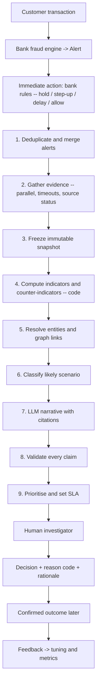
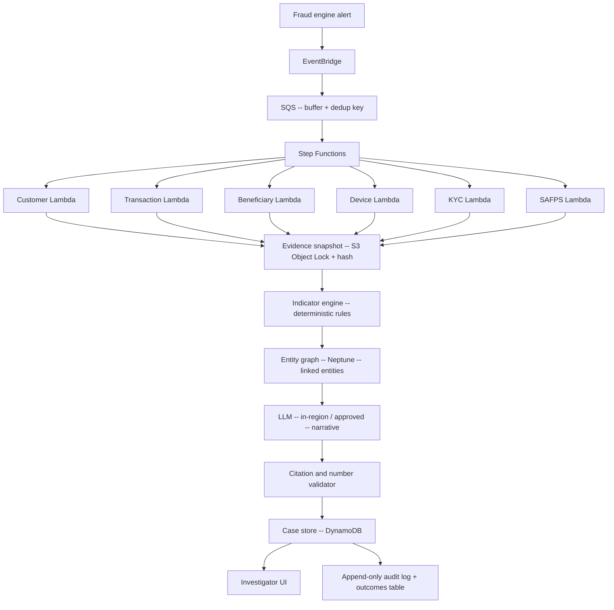

# 1. High-Level Design — Fraud Investigation Copilot

Companion to `BRS.md` and `USER_STORIES.md`. Diagrams reproduce and elaborate
`../fraud-investigation-copilot.md` §4 (flow) and §5 (architecture).

## 2. Revised Flow



## 3. Revised Architecture



Each of the six evidence Lambdas (including SAFPS — LLD §3.1 #6, filling the industry data-sharing
slot the source design reserves at §3.4) runs with its own timeout, retry policy, and returns an
explicit status (see `LLD.md` §3.2), so a slow or failed source never silently reads as "nothing
found."

## 4. Component Responsibilities

| # | Layer | Responsibility | Components |
|---|-------|-----------------|-----------|
| 1 | Plumbing | Move events, gather evidence in parallel, handle retries/timeouts | EventBridge, SQS, Step Functions, the 6 evidence Lambdas (incl. SAFPS) |
| 2 | Fact engine | Compute indicators, counter-indicators, entity graph links — deterministically, from the frozen snapshot only | Indicator engine, entity graph (Neptune-shaped) |
| 3 | Explainer | Write cited narratives from computed facts; find similar past case narratives (RAG) | LLM narrative generator, citation/number validator |
| 4 | Product | What the investigator actually uses | Case store, investigator UI, audit log, outcomes table |

## 5. Case Screen (product surface)

Reproduced from design §6 — see `LLD.md` §6 for the underlying case schema that populates it:

```text
┌─────────────────────────────────────────────┐
│ CASE #18291     PRIORITY: HIGH  SLA 38 min   │
│ R85,000 transfer — PAYMENT HELD              │
│ Likely scenario: customer scammed (APP)      │
│ Evidence incomplete: device data timed out   │
│                                               │
│ INDICATORS                  [evidence link]  │
│ • Amount 10.6x 12-month max        [E1]      │
│ • Beneficiary added 14 min before  [E2]      │
│ • Beneficiary linked to 3 cases    [E5]      │
│                                               │
│ COUNTER-INDICATORS                           │
│ • Login from usual device & city   [E3]      │
│ • No password reset or SIM swap    [E4]      │
│                                               │
│ LINKED ENTITIES (graph)            [VIEW]    │
│ AI NARRATIVE (all claims cited)    [VIEW]    │
│                                               │
│ ACTIONS                                      │
│ [CONTACT CUSTOMER] [RELEASE] [BLOCK]         │
│ [ESCALATE] [REQUEST INFO] [START STR]        │
│ [GENERATE SAPS PDF]                          │
│                                               │
│ Reason code: [ required ]  Rationale: ___    │
└─────────────────────────────────────────────┘
```

`GENERATE SAPS PDF` (LLD §6.1) is investigator-triggered like every other action, but does not
require a reason code — it exports evidence for the customer's own SAPS report rather than
committing a fraud decision. It is logged to the audit trail the same as any decision action.

## 6. Non-Functional Requirements

| # | Category | Requirement | Traces to |
|---|----------|-------------|-----------|
| 1 | Latency / SLA | Evidence gathering completes within each source's configured timeout; case creation does not block on a slow source — it ships with `NOT_AVAILABLE`/`FAILED` marked | US-B.1, US-C.3 |
| 2 | Availability of evidence | Every source call has retry + explicit timeout; no unbounded wait | US-B.1 |
| 3 | Idempotency | Reprocessing the same alert (EventBridge at-least-once) never creates a duplicate case | US-A.1 |
| 4 | Immutability | Evidence snapshot is write-once and hashed; nothing downstream can mutate it | US-C.1 |
| 5 | Security / POPIA | PII masked by default; least-privilege IAM; encryption at rest; approved region only; no bank data used for model training | US-B.3, US-H.1, BRS §6 |
| 6 | Auditability | Every decision, evidence view, and validation result is recorded append-only | US-F.2 |
| 7 | Fail-safe AI | Pipeline never blocks on LLM/data-source availability — always ships raw evidence + indicators, narrative optional | US-E.2 |
| 8 | Reproducibility | Indicator computation is deterministic given the same snapshot — no hidden state or randomness | US-C.2 |
| 9 | Tipping-off isolation | STR workflow is a separate, restricted path from customer-communication actions | US-F.1, BRS §6 |
